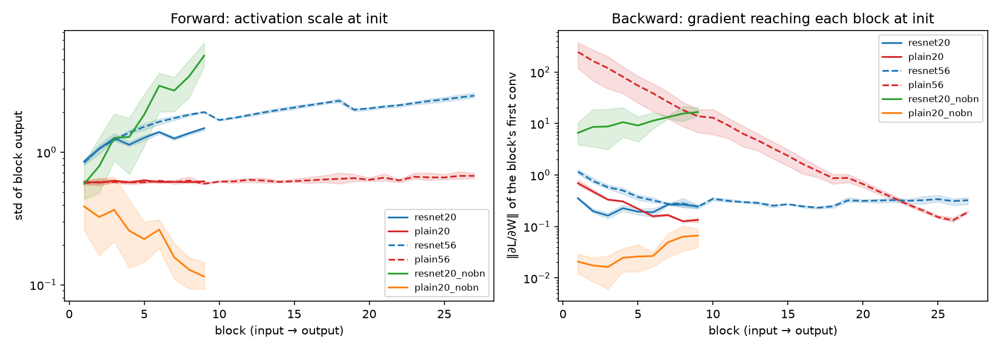

# NOTES: the concepts behind Project 3

These are the ideas the ablations test. For each one there is a short
derivation and the measurement in this repo that checks it. Read §1–§4 before
looking at the results.

---

## 1. The degradation problem (it is NOT overfitting)

He et al. 2015, Fig. 1: a 56-layer plain network has **higher training
error** than a 20-layer one, not just higher test error.

Why that rules out overfitting:

| | overfitting | degradation |
|---|---|---|
| training error | low (the model fits the data *too* well) | **high**: the deeper model fits the training data *worse* |
| test error | high | high |
| fix | regularize, more data | make the deep model easier to *optimize* |

**The construction argument.** Take a trained 20-layer net. Insert 36 extra
layers that each compute the identity. The result is a 56-layer net with
*exactly* the 20-layer training error. So a 56-layer solution at least as good
as the 20-layer one **exists**, and the deeper model's capacity is not the
issue. The worse training error means SGD **can't find** that solution in
practice. Degradation is an optimization failure.

Why can't it? Two separate reasons, and our gradient-flow measurement (§3)
shows the second:

1. **Identity is hard to express for a plain layer.** `relu(BN(conv(x)))`
   can only approximate the identity by learning a precise kernel (a centred
   delta) *and* undoing the BN normalization. Zero weights, the easy default,
   give the zero map, not the identity.
2. **The gradient signal through a deep plain stack is badly conditioned.**
   The ResNet paper notes that with BN the gradients don't *vanish* (and we
   confirm it). They are still a long product of layer Jacobians, which
   explodes toward the input at init (§3) and becomes noise-like ("shattered
   gradients", Balduzzi et al. 2017).

## 2. Residual connections and gradient flow

A residual block computes `x_{l+1} = x_l + F(x_l)`. Unroll it from block l to
a deeper block L (ignoring the ReLU after the add for a moment; He et al. 2016,
"Identity mappings", removes it to make this exact):

    x_L = x_l + Σ_{i=l}^{L-1} F(x_i)

Differentiate:

    ∂L/∂x_l = ∂L/∂x_L · ( I + ∂/∂x_l Σ_{i=l}^{L-1} F(x_i) )

The **`I` term** carries the gradient from the loss to every block directly,
without passing through any weight layer. In a plain network the gradient is
instead a **product** `∏ ∂x_{i+1}/∂x_i`, and a product of L terms grows or
shrinks exponentially in L unless every factor has norm almost exactly 1.

Two consequences:

- **Learning the identity is the default.** If a block's weights go to
  zero, `F = 0` and the block passes x through unchanged
  (`tests/test_models.py::test_block_with_zero_residual_branch_is_identity`). A
  useless block costs nothing. That is the precise sense in which "the extra
  layers can learn the identity".
- **Shallow paths.** Expanding the sum shows a ResNet is a collection of
  2^n paths of different lengths. Most of the gradient flows through the short
  ones (Veit et al. 2016), so the effective depth for gradient flow is much
  smaller than the nominal depth.

### Measured (`scripts/grad_flow.py`, at initialization, 3 seeds)

| network | activation std, first → last block | ‖∂L/∂W‖, first → last block | ratio first/last |
|---|---|---|---|
| ResNet-20 | 0.85 → 1.5 | 0.35 → 0.24 | 1.5 |
| Plain-20 | 0.6 → 0.6 | 0.69 → 0.13 | 5.2 |
| ResNet-56 | 0.84 → 2.7 | 1.2 → 0.32 | 3.6 |
| **Plain-56** | 0.58 → 0.66 | **250 → 0.19** | **1300** |
| ResNet-20, no BN | 0.58 → **5.3** | 6.6 → 17 | 0.39 |
| Plain-20, no BN | 0.39 → 0.12 | 0.021 → 0.066 | 0.31 |

What this shows:

- **With BN, plain-56's forward signal is perfectly healthy** (std ~0.6 at
  every block). BN renormalizes every layer, so "the signal dies" is not
  the problem.
- **Its backward signal explodes toward the input: about 1.32× per block,
  so it is 1300× larger at block 1 than at block 27.** This is the opposite of
  the vanishing-gradient story people usually tell. It is the gradient
  explosion that Yang et al. 2019 proved is unavoidable in deep plain
  networks with BN at init. The first layers get huge, noisy updates while the
  last layers barely move.
- **ResNets keep the per-block gradient within ~4× across all 27 blocks.**
  That is the `I` term at work.
- **Without BN, the residual sum makes activations grow**: each block adds a
  He-initialized branch of similar variance to its input, so the variance
  grows ~1.75× per block (9× in std over 9 blocks). The logits start with std
  2.2 and the initial loss is 4.65, against log 10 = 2.30 for a calibrated
  guess. This predicts that lr 0.1 may be too aggressive without BN (§6).

## 3. BatchNorm: what it does, at train vs eval time

For each channel c, over a batch of N images and all H×W positions:

    μ_B = mean(x),  σ²_B = var(x)            (statistics of THIS batch)
    x̂ = (x − μ_B) / sqrt(σ²_B + ε)
    y = γ x̂ + β                               (γ, β learned per channel)

**Train mode** uses the batch statistics μ_B and σ²_B, and also updates the
running averages:

    running_mean ← (1 − m) · running_mean + m · μ_B        (PyTorch: m = 0.1)
    running_var  ← (1 − m) · running_var  + m · σ²_B·N/(N−1)  (unbiased)

**Eval mode** uses the frozen `running_mean` and `running_var` instead. Why
the difference?

- At test time you may have one image, and a prediction must not depend on
  which other images happen to share its batch. In train mode it does
  (`tests/test_models.py::test_batchnorm_train_vs_eval` shows that changing
  the *other* images changes an image's logits).
- That batch dependence is also a mild regularizer: each example sees a
  slightly different normalization every step, a kind of noise.

Practical consequences:

1. **Always call `model.eval()` before evaluating.** Forgetting it gives
   batch-dependent, often worse, test accuracy.
2. **Conv bias before BN is wasted.** BN subtracts the mean, which removes any
   bias, and β plays its role. That's why `bias=not use_bn` in `models.py`.
3. **Batch size matters.** With tiny batches, μ_B and σ²_B are noisy, and the
   train/eval mismatch grows. We drop the last partial batch for this reason.

**Why BN made deep nets trainable** (Ioffe & Szegedy 2015 and later work):
- It keeps every layer's input at zero mean and unit variance whatever the
  weights do. Our no-BN ResNet shows what happens otherwise: activations grow
  ~1.3× per block.
- It allows much higher learning rates. The original "internal covariate shift"
  explanation is disputed. Santurkar et al. 2018 argue the real effect is a
  smoother loss landscape.
- **Scale invariance.** BN(αWx) = BN(Wx) for any α > 0, so the loss doesn't
  depend on ‖W‖ for a conv followed by BN. That matters for weight decay (§4).

## 4. Weight decay with BatchNorm: not what you think

Classic view: weight decay (L2) penalizes large weights, which limits
capacity and so reduces overfitting.

With BN this view breaks. Each conv is followed by BN, so the loss is
**invariant to the scale of W**. Shrinking W doesn't change the function at
all, and it can't limit capacity. What does weight decay do then?

Scale invariance has two consequences (calculus on f(αW) = f(W)):

    ∇f(αW) = ∇f(W) / α          (the gradient shrinks as the weights grow)
    ⟨∇f(W), W⟩ = 0               (the gradient is orthogonal to W)

So one SGD step changes W's *direction* by about η‖∇f‖/‖W‖, and the
gradient itself scales as 1/‖W‖. The **effective learning rate** for the
direction is therefore

    η_eff ≈ η / ‖W‖²

Without weight decay, every step adds an orthogonal vector, so
‖W_{t+1}‖² = ‖W_t‖² + η²‖g‖², and the norm **only grows**. The effective
learning rate then decays on its own, and training cools down too early.
**Weight decay keeps ‖W‖ small, so η_eff stays high.** That is the
mechanism (van Laarhoven 2017; Zhang et al. 2019, "Three mechanisms of weight
decay regularization").

That's why `train.py` logs `weight_norm` every epoch. The WD ablation
predicts that the norm grows steadily without weight decay and stays roughly
flat with it.

## 5. Adam vs AdamW: decoupling weight decay

With L2 regularization added to the loss, the gradient becomes `g + λθ`.

- **SGD:** θ ← θ − η(g + λθ) = (1 − ηλ)θ − ηg. "L2 regularization" and
  "multiply the weights by (1 − ηλ) each step" (weight decay) are **the same
  thing** for SGD.
- **Adam with L2:** the decay term goes into the moment estimates and gets
  divided by √v̂ like the rest of the gradient:

      θ ← θ − η · m̂(g + λθ) / (√v̂ + ε)

  A weight with *large* historical gradients (large v̂) is decayed *less*,
  and one with small gradients is decayed *more*. The regularization strength
  now depends on gradient history, which isn't what anyone intended. For Adam,
  L2 regularization ≠ weight decay.
- **AdamW** (Loshchilov & Hutter 2017) applies the decay *outside* the
  adaptive step:

      θ ← θ − η · ( m̂(g) / (√v̂ + ε) + λθ )

  Every weight shrinks by the same factor (1 − ηλ) per step, exactly as in
  SGD. The decay is "decoupled" from the gradient statistics, so the best
  λ and the best η also become more independent.

**How we set the strength so the comparison is fair.** The decoupled shrink
per step is ηλ. The SGD baseline has ηλ = 0.1 × 1e-4 = 1e-5. AdamW at
η = 1e-3 gets the **same per-step shrinkage** with λ = 1e-2, and that is what
`configs/resnet20_adamw.yaml` uses. Adam keeps the naive L2 coefficient 1e-4,
"what you'd get by swapping the optimizer and changing nothing else".

## 6. Predictions, written before the GPU runs

The ResNet paper's numbers (182 epochs): ResNet-20 8.75% test error,
ResNet-56 6.97%. Plain-56 trains *worse* than plain-20.

1. **Degradation:** plain-56 has higher **training** error than plain-20
   throughout training, *and* higher test error. ResNet-56 beats ResNet-20 on
   both. The error ranking is the paper's.
2. **BN:** at lr 0.1 the no-BN ResNet-20 is unstable (activations grow
   1.3× per block, initial loss 4.65). It either diverges or ends clearly worse.
   At lr 0.01 it trains, but ends several points behind the BN baseline.
3. **WD:** without weight decay, test error rises by ~0.5–1.5 points, and
   ‖W‖ grows steadily instead of levelling off (§4).
4. **Optimizers:** SGD+momentum ≥ AdamW > Adam (with L2). Adam's gap comes from
   its weak, gradient-dependent regularization (§5) and from the well-known
   generalization gap of adaptive methods on CIFAR ResNets (Wilson et al.
   2017).

## 7. Experiment discipline (what makes an ablation trustworthy)

- **Change one thing at a time** against one shared baseline. All 9 variants
  differ from `resnet20.yaml` in exactly one field (or in depth, for the
  degradation grid). The one exception is deliberate and explained: the no-BN
  run gets a second learning rate.
- **Same everything else:** data split (seed 0), augmentation, batch size,
  schedule shape, epoch budget, init, and code path.
- **3 seeds, mean ± std.** A seed changes the init, the data order and the
  augmentation. Differences smaller than ~2 std are not claims.
- **No selection on the test set.** We report the *final* epoch, not the
  best one. The test error is logged per epoch for the curves only.
- **Write predictions first** (§6), then compare.
- **Reproducible:** each run writes its exact config, re-running a command
  resumes or skips it, and `tests/test_train.py` checks that an interrupted
  and resumed run gives *bit-identical* weights.

---

## Check yourself

1. Plain-56 has higher *training* error than plain-20. Explain why this
   cannot be overfitting, and give the construction argument for why a
   56-layer net *could* do at least as well.
2. Derive ∂L/∂x_l for `x_{l+1} = x_l + F(x_l)` over several blocks. Which
   term makes the gradient flow, and what replaces it in a plain net?
3. Our plain-56 with BN has a perfectly healthy forward signal at init, but
   the gradient at the first block is 1300× that at the last. Why doesn't BN
   fix the backward pass too?
4. What exactly differs between `model.train()` and `model.eval()` for BN?
   Name one bug that comes from forgetting `model.eval()`.
5. With BN after a conv, the loss doesn't change when you scale W by 2. So
   what *does* weight decay do in such a network? Use η_eff ≈ η/‖W‖².
6. For SGD, L2 regularization and weight decay are identical. Show why they
   differ for Adam, and write the AdamW update.
7. Why did we give the no-BN network a second learning rate, while every other
   ablation uses the baseline's hyperparameters? When is changing a second
   variable *more* fair, not less?
