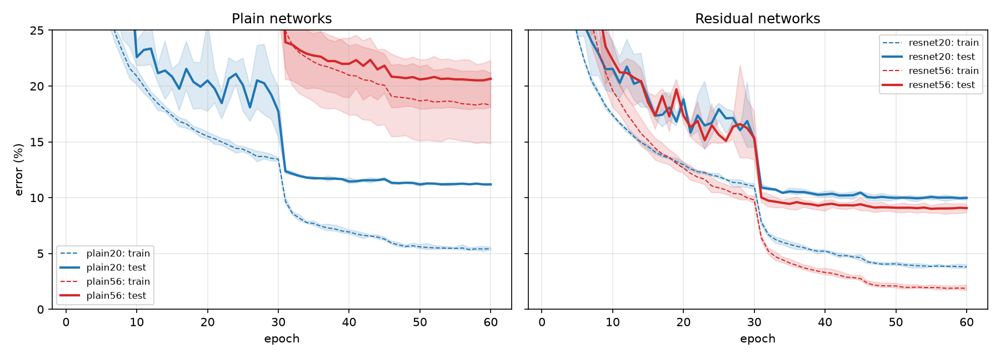
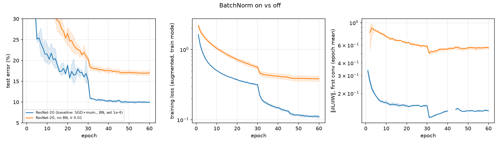
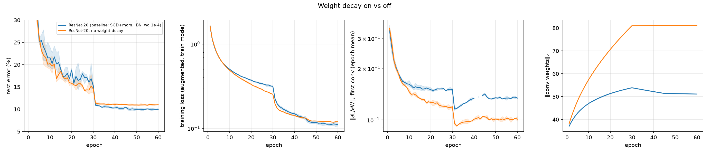
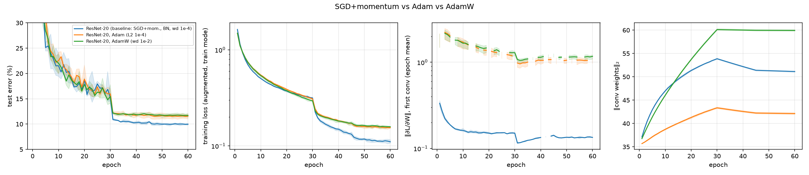

# resnet-ablations

ResNet-20/56 and their plain counterparts for CIFAR-10, written from scratch in
PyTorch (no torchvision models), plus a controlled ablation study. It covers
the degradation problem, BatchNorm, weight decay, and SGD vs Adam vs AdamW,
with 3 seeds per variant.

**Status: complete (60-epoch budget).** All 27 runs (9 variants × 3 seeds)
were trained on Kaggle's 2×T4 in 1 h 23 min. The results are in §6.2–6.8.

**Headline results** (test error, mean of 3 seeds):
- **Degradation is reproduced.** Plain-56 is 20.6% vs Plain-20's 11.2%, with
  higher *training* error at every epoch. With residual connections, ResNet-56
  (9.1%) beats ResNet-20 (10.0%).
- **Removing BN costs 7 points** (and lr 0.1 diverges).
- **Removing weight decay costs 1 point.**
- **SGD + momentum beats Adam and AdamW by ~1.6 points**, and Adam and AdamW
  tie.

---

## 1. What's here

```
resnet/
  models.py        CifarNet(depth, residual, use_bn): ResNet-(6n+2) and the plain twin; option-A shortcut
  data.py          CIFAR-10 binary loader, 45k/5k/10k split, on-GPU crop+flip augmentation
  train.py         Config, one run: seeded, checkpointed every epoch, resumable, CSV log
configs/*.yaml     the 9 variants; each differs from resnet20.yaml in ONE field
scripts/
  train.py         python -m scripts.train --config configs/X.yaml [--any_field value]
  run_ablation.py  all runs of an ablation x 3 seeds; skips finished runs; --shard for 2 GPUs
  benchmark.py     measures s/epoch on this machine and prints each budget's cost
  grad_flow.py     gradient/activation flow at init (CPU, ~1 min)
  analyze.py       runs/ -> results table + figures
  download_data.py CIFAR-10 binary with MD5 check
notebooks/run_on_gpu.ipynb   Kaggle/Colab driver: setup, benchmark, 2-GPU sharding, packaging
tests/             41 tests
NOTES.md           degradation, residual gradient flow, BN train/eval, WD with BN, AdamW; predictions
```

## 2. Model

| stage | output | layers (ResNet-20: n = 3; ResNet-56: n = 9) |
|---|---|---|
| stem | 16 × 32 × 32 | conv3×3, BN, ReLU |
| 1 | 16 × 32 × 32 | n basic blocks |
| 2 | 32 × 16 × 16 | n basic blocks, first with stride 2 |
| 3 | 64 × 8 × 8 | n basic blocks, first with stride 2 |
| head | 10 | global average pool, fc |

A basic block is `relu(BN(conv(relu(BN(conv(x))))) + shortcut(x))`. The
shortcut is **option A** (the paper's choice for CIFAR): the identity, or, when
the shape changes, subsample by 2 and zero-pad the new channels. It has no
parameters, so **plain and residual nets have identical parameter counts**:
269,722 for depth 20 and 853,018 for depth 56. These match the paper's
0.27M / 0.85M, and a test checks them.

**Training recipe** (He et al. 2015, §4.2): SGD, momentum 0.9, weight decay
1e-4, batch 128, lr 0.1 divided by 10 at 50% and 75% of training. Augmentation
is a 4-pixel-padded random crop and a horizontal flip. Train on 45k images,
validate on 5k, test on the 10k test set. The paper's budget is 64k iterations,
which is 182 epochs.

## 3. Compute plan: what needs a GPU

| step | where | time |
|---|---|---|
| tests, gradient-flow analysis, smoke runs | laptop | minutes |
| **the 27 ablation runs** | **GPU: Kaggle (2×T4) or Colab (T4)** | see below |
| analysis and figures | laptop | seconds |

On the MacBook Air (M5, MPS), ResNet-20 takes **18 s/epoch when cool**. Under
sustained load the fanless Air throttles, and the same step time varied by up
to 4×. A 182-epoch run would take 1–3 hours, so the laptop isn't used for the
ablations.

Cost of all 27 runs (9 variants × 3 seeds), from `python -m scripts.benchmark`
(run it on the GPU you'll use; the notebook does this first):

| budget | MacBook Air M5 (MPS, measured) | T4 (pre-run estimate: ~10 s/epoch for ResNet-20; measured: 5.0 s) |
|---|---|---|
| ResNet-20 / ResNet-56 per epoch | 20.3 s / 54.5 s | ~10 s / ~28 s |
| 60 epochs, all 27 runs | 12.6 h, if it didn't throttle | ~6 GPU-h, i.e. ~3 h on Kaggle 2×T4 |
| 182 epochs, all 27 runs | 38 h | ~19 GPU-h, i.e. ~10 h on Kaggle 2×T4 |

**Chosen budget: 60 epochs (reduced).** The schedule keeps the paper's shape:
lr steps at epochs 30 and 45. At an *estimated* ~10 s/epoch on a T4 (the
notebook measures the real figure before anything starts), all 27 runs take
~6 GPU-hours, about 3 hours on Kaggle's 2×T4. That is comfortably inside the
free weekly quota, so every comparison gets 3 seeds. The cost of reducing it is honest and specific:

- Absolute errors will be ~0.5–1 point worse than the paper's 182-epoch
  numbers, so compare *variants with each other*, not with the paper.
- Effects that only build up late in training (e.g. weight decay's slow
  control of the weight norm, §4 of NOTES) may be **understated**.
- The full budget is available as a second stage: re-run with `--epochs 182`.
  It writes to `runs/e182`, kept separate from the 60-epoch runs.

## 4. Install and run

```bash
conda env create -f environment.yml && conda activate resnet    # or: pip install -r requirements.txt
python -m scripts.download_data
python -m pytest -q                          # 41 tests, ~1 min
python -m scripts.grad_flow                  # §5, CPU
# GPU (or open notebooks/run_on_gpu.ipynb on Kaggle/Colab):
python -m scripts.run_ablation all --epochs 60
python -m scripts.analyze --runs runs/e60
# a single run, any field overridable:
python -m scripts.train --config configs/plain56.yaml --seed 1 --epochs 60
```

`./run_all.sh [EPOCHS]` runs all of it. Every run is resumable: if a session
dies, re-run the same command.

**Getting the code onto Kaggle or Colab:** push the repo to GitHub and set
`REPO_URL` in the notebook, or make a zip and upload it (as a Kaggle Dataset,
or to Google Drive for Colab):

```bash
cd .. && zip -qr resnet-ablations.zip resnet-ablations -x "*/data/*" "*/runs/*" "*/__pycache__/*" "*.pt"
```

Bring the results back by downloading `results_e60.zip` from the notebook and
unzipping it in this folder. It contains the logs and summaries, but no
checkpoints.

## 5. Verification and infrastructure tests

| test | checks |
|---|---|
| block and network shapes | every block config (stride 1/2, channels, residual on/off, BN on/off), the stage outputs 32→16→8 |
| shortcut is identity when shapes match | it returns *the same tensor object* and has no parameters |
| zero residual branch gives the identity | with F = 0 a residual block returns x, and a plain block returns 0 |
| option-A downsampling | the original channels pass through, the padding is exactly zero |
| parameter counts | 269,722 / 853,018, plain = residual |
| BN train vs eval | in train mode an image's output depends on its batch-mates, in eval mode it doesn't; running stats update only in train mode |
| **overfit a tiny batch** | 32 random images with random labels → loss < 0.05, 100% accuracy in eval mode, for both residual and plain |
| augmentation | every output is a window of the padded input (or its mirror); all 9 vertical offsets occur |
| **resume = uninterrupted** | a run killed after epoch 2 and resumed has **bit-identical** weights to one that never stopped |
| config safety | all configs load; a misspelled key is an error, not silently ignored |

These injected bugs were caught (each made at least one test fail):
`randint(0, 2*pad)` instead of `2*pad + 1` (crop offset 8 never happens);
not restoring the augmentation RNG, the optimizer, or the LR scheduler on resume;
padding option-A channels on one side only.

## 6. Results

### 6.0 Gradient flow at initialization (CPU, 3 seeds)


| network | ‖∂L/∂W‖, first → last block | ratio | initial loss |
|---|---|---|---|
| ResNet-20 | 0.35 → 0.24 | 1.5 | 2.63 |
| Plain-20 | 0.69 → 0.13 | 5.2 | 2.35 |
| ResNet-56 | 1.2 → 0.32 | 3.6 | 3.75 |
| **Plain-56** | **250 → 0.19** | **1300** | 2.36 |
| ResNet-20, no BN | 6.6 → 17 | 0.39 | 4.65 |

**With BN, the deep plain net's problem isn't vanishing gradients. They
explode toward the input**, ~1.32× per block. Its forward activations are
perfectly normalized (std ≈ 0.6 everywhere). ResNets keep the gradient within
~4× across all blocks. Without BN, the residual sums make activations grow
~1.3× per block, and the initial loss is 4.65 (vs log 10 = 2.30). Details in
NOTES §2.


### 6.1 The one hyperparameter choice: the no-BN learning rate (validation only)

The smoke run showed **ResNet-20 without BN diverges (NaN) in its first
epoch at lr 0.1**, as §6.0 predicts. Giving it only lr 0.1 would test "lr too
high" rather than "no BN", so we picked its lr with a 2-epoch probe (seed 0,
no decay), judged on **validation** accuracy:

| lr | 0.1 | 0.03 | 0.01 | 0.003 | 0.001 |
|---|---|---|---|---|---|
| val acc after 2 epochs | NaN (diverged) | 9.7% (collapsed, no NaN) | 29.9% | 31.9% | 32.7% |
| *baseline with BN, lr 0.1* | *61.8%* | | | | |

The three stable rates are within 3 points of each other, and all are about
30 points behind the BN baseline. **No lr rescues the no-BN net early in
training.** We run lr 0.01, the largest stable rate. That is the usual
choice, because a 2-epoch probe can't tell which of three close rates wins after
60 epochs, and the step schedule lowers it later anyway. The lr 0.1 arm is kept
too, as a recorded divergence (it costs seconds).

### 6.2 Main table (60 epochs, 3 seeds, final epoch, mean ± sample std)

Run on Kaggle (2×T4, one shard per GPU): all 27 runs in **1 h 23 min of
wall-clock time**. ResNet-20 took a median 5.0 s/epoch and ResNet-56 13.1
s/epoch, half the 10 s/epoch estimate in §3. From `results/e60/table.md`:

| variant | test error (%) | train error (%) | train loss | val error (%) | diverged |
|---|---|---|---|---|---|
| **ResNet-20 (baseline: SGD+mom., BN, wd 1e-4)** | **9.98 ± 0.18** | 3.80 ± 0.16 | 0.11 ± 0.01 | 9.32 ± 0.37 | 0/3 |
| Plain-20 | 11.19 ± 0.08 | 5.43 ± 0.12 | 0.16 ± 0.00 | 10.99 ± 0.27 | 0/3 |
| ResNet-56 | 9.07 ± 0.39 | 1.87 ± 0.27 | 0.06 ± 0.01 | 8.28 ± 0.20 | 0/3 |
| Plain-56 | 20.65 ± 2.25 | 18.29 ± 3.20 | 0.53 ± 0.09 | 20.23 ± 1.82 | 0/3 |
| ResNet-20, no BN, lr 0.1 | — | — | — | — | **3/3** (epoch 1) |
| ResNet-20, no BN, lr 0.01 | 17.02 ± 0.56 | 13.48 ± 1.25 | 0.38 ± 0.03 | 16.88 ± 0.71 | 0/3 |
| ResNet-20, no weight decay | 11.00 ± 0.09 | 4.25 ± 0.07 | 0.12 ± 0.00 | 10.32 ± 0.25 | 0/3 |
| ResNet-20, Adam (L2 1e-4) | 11.58 ± 0.50 | 5.27 ± 0.11 | 0.15 ± 0.00 | 10.65 ± 0.32 | 0/3 |
| ResNet-20, AdamW (wd 1e-2) | 11.71 ± 0.35 | 5.44 ± 0.10 | 0.16 ± 0.00 | 11.53 ± 0.23 | 0/3 |

Validation error ranks the variants in the same order as test error, with one
swap of two close variants: Plain-20 and Adam (val 10.99 vs 10.65, test 11.19
vs 11.58). So nothing here depends on having looked
at the test set.

The paper (182 epochs) reports 8.75% for ResNet-20 and 6.97% for ResNet-56. We
are **1.2 and 2.1 points worse**, more than the 0.5–1 point §3 guessed, and
the gap grows with depth. Plausibly the deeper net is hurt more by the
3× shorter schedule, but the comparison is never run here (see §7).

### 6.3 Degradation



*Dashed lines are training error (augmented batches, train mode); bold lines
are test error. Bands show the min–max over 3 seeds.*

- **Plain-56 is worse than Plain-20 on training error at every one of the 60
  epochs** (mean over seeds), not just at the end. The final training errors
  are 18.3% vs 5.4%, and test errors 20.6% vs 11.2%. The deeper net fits the
  *training* set worse, so the gap can't be overfitting. It is an optimisation
  failure, as He et al. argue.
- At epoch 10, Plain-56's training error is still 58% (Plain-20: 21%).
  That fits §6.0: its gradient at the first layer is 1300× the last layer's at
  initialisation. Its first-layer weights blow up: ‖W‖ is 483 ± 227 after
  epoch 1, compared with 37 for every other net.
- Plain-56 is also by far the **least reproducible** (test 22.3 / 21.6 /
  18.1% across seeds). A badly conditioned optimisation is sensitive to the
  initial point.
- **With residual connections the ranking flips back.** ResNet-56 beats
  ResNet-20 on training error (1.9% vs 3.8%) and on test error (9.07 ± 0.39
  vs 9.98 ± 0.18; the gap is ~3 pooled std). Over the first ~10 epochs
  ResNet-56 is the slower of the two, and it is ahead on training error in 42
  of the 60 epochs.
- Depth 20 is not deep enough to show much: Plain-20 is only 1.2 points behind
  ResNet-20.

### 6.4 BatchNorm



- **lr 0.1 without BN: all 3 seeds produced NaN in the first epoch.** This is
  the instability §6.0 measured at initialisation (activations grow 1.3×
  per block; initial loss 4.65).
- **lr 0.01 without BN trains but finishes 7.0 points behind** (17.02% vs
  9.98%). Its *training* error (13.5%) is also far higher, so again this is
  optimisation, not generalisation. BN's contribution here is mostly that it
  lets the network train fast at a high learning rate.
- The middle panel shows the no-BN net is slower at *every* stage, including
  after both lr drops. A better lr would not obviously close a 7-point gap,
  which agrees with the 2-epoch probe in §6.1.

### 6.5 Weight decay



- **No weight decay costs 1.02 points** (11.00 ± 0.09 vs 9.98 ± 0.18, more
  than 5 std apart).
- **Before the first lr drop, the no-WD net is *ahead*** on test error (15.1% vs
  16.9% mean over epochs 20–30) and on training loss. The WD benefit
  appears **only after the lr is decayed**, at epoch 30. This is the
  effective-learning-rate picture of NOTES §4, where WD matters through what it
  does to ‖W‖ and so to η/‖W‖², rather than as a classic regulariser that
  would help throughout.
- **Weight norm (right panel).**
  - Without WD, ‖W‖ grows from 38 to 81 by epoch 30, then **stops**. After
    the lr ÷10, each step adds η²‖g‖² to ‖W‖², which is 100× less.
  - With WD it reaches only 54, then *shrinks slowly* to 51. After the drop,
    the decay term (∝ η) outweighs the growth term (∝ η²).
  - So without WD the effective lr at the end is ~(81/51)² ≈ 2.5× smaller.

### 6.6 SGD + momentum vs Adam vs AdamW



- **SGD + momentum wins by ~1.6–1.7 points** (9.98 vs 11.58 / 11.71). Note
  that Adam and AdamW also *fit the training set* worse (training error 5.3–5.4%
  vs 3.8%). They keep pace with SGD until epoch 30 (training error 10.8 / 10.3 vs
  11.0%), then gain less from the lr drops.
- **Adam and AdamW are tied** (11.58 ± 0.50 vs 11.71 ± 0.35: 0.13 points
  apart, well under 1 std). Decoupling the decay did not help at this
  strength and budget.
- The two do differ in **‖W‖**: Adam (L2) ends at 42, SGD at 51, AdamW at 60.
  - Adam's L2 term is divided by √v̂. The BN-preceded conv weights have small
    gradients, so that decay is *amplified*, the direction NOTES §5 predicts.
  - AdamW was given the same per-step shrink ηλ as SGD, yet ends *larger*.
    The shrink was matched, but the growth term was not: an Adam step has a
    roughly fixed size per weight, whatever the gradient scale.
  - A different ‖W‖ did not translate into a different test error.

### 6.7 Predictions (NOTES §6) vs results

| # | prediction | outcome |
|---|---|---|
| 1 | Plain-56 worse than Plain-20 on train *and* test throughout; ResNet-56 beats ResNet-20 on both | **right**: worse train error at all 60 epochs; ResNet-56 better on both |
| 2 | no BN, lr 0.1 diverges or ends clearly worse; lr 0.01 trains but several points behind | **right**: 3/3 NaN in epoch 1; lr 0.01 is 7.0 points behind |
| 3 | no WD: +0.5–1.5 points; ‖W‖ grows steadily without WD and levels off with it | **half right**: +1.02 points; but without WD ‖W‖ *stops* growing at the lr drop, and with WD it grows 37→54 before shrinking |
| 4 | SGD+momentum ≥ AdamW > Adam | **half right**: SGD is clearly best, but AdamW and Adam are tied |

The absolute-error guess (0.5–1 point worse than the paper) was also wrong.
The real gap is 1.2 points for ResNet-20 and 2.1 for ResNet-56.

### 6.8 What I learned

- **Degradation is real and easy to reproduce, and it's an optimisation
  problem.** Plain-56 fits the *training* set worse. In this setup BN does not
  make the deep plain net trainable. The gradients are well scaled forward and
  explode backward toward the input (§6.0).
- **Residual connections and BN fix different things.** Removing BN from a
  ResNet costs more (7 points) than removing the residuals from a 20-layer net
  (1.2 points).
- **With BN, weight decay works through the effective learning rate.** Its
  benefit is invisible, even reversed, until the lr is decayed, and the ‖W‖
  curves behave as the scale-invariance argument says.
- **On CIFAR ResNets, AdamW is not automatically better than Adam.** "Decoupled
  is better" is a statement about tuning λ and η independently. With one
  setting each, they tie, and both trail SGD.
- **Check the logs for non-finite values before plotting.** See §7: the
  gradient-norm log had infinities from fp16 overflow steps.

## 7. Limitations

- **60 epochs, not 182.**
  - Every absolute number is 1–2 points behind the paper.
  - Weight decay never reaches its equilibrium norm. Its time constant
    1/(2ηλ) is 50k steps at lr 0.1, against 10.5k steps before the first
    drop. Its effect is therefore probably **understated**.
  - The ResNet-56 vs ResNet-20 gap (0.9 points, vs 1.8 in the paper) may grow
    with the full budget.
  - `--epochs 182` writes to `runs/e182`. At the measured T4 speed, all 27 runs
    would take about 4 hours on Kaggle's 2×T4.
- **3 seeds.** The std estimates are rough, especially Plain-56's (±2.25). The
  differences we call claims are ≥ 3 pooled std. The Adam/AdamW tie is a
  *non-difference*: 3 seeds cannot rule out a gap of ~0.5 points.
- **One hyperparameter setting per variant.**
  - Adam/AdamW used η = 1e-3 and SGD's step schedule, with no tuning. Tuned
    adaptive optimisers do close part of the gap in the literature.
  - The no-BN lr was chosen from a 2-epoch probe (§6.1).
  - So §6.6 compares *default* settings, not each method's best.
- **The gradient-norm curves have gaps.** In 61 of 1440 logged epochs (mostly
  the Adam/AdamW runs, and epoch 1 of the deep plain net), at least one fp16
  step overflowed. The AMP gradient scaler skips such a step, so **training
  was unaffected**. But its infinite norm went into the epoch mean, and those
  epochs show as breaks on the log-scale plots. `train.py` now leaves
  overflowed steps out of the mean. The runs here were made before that fix.
- **Mixed precision (fp16 autocast) on the GPU**, vs fp32 in the paper. This
  probably matters little for these nets, but it was not checked.
- **CIFAR-10 only**, and only depths 20 and 56. The paper's 110- and 1202-layer
  results, and other datasets, are not tested.

## 8. References

- K. He, X. Zhang, S. Ren, J. Sun. *Deep residual learning for image recognition.* CVPR 2016 (arXiv 2015).
- K. He et al. *Identity mappings in deep residual networks.* ECCV 2016.
- S. Ioffe, C. Szegedy. *Batch normalization: accelerating deep network training by reducing internal covariate shift.* ICML 2015.
- I. Loshchilov, F. Hutter. *Decoupled weight decay regularization.* ICLR 2019 (arXiv 2017).
- D. Balduzzi et al. *The shattered gradients problem: if resnets are the answer, then what is the question?* ICML 2017.
- G. Yang et al. *A mean field theory of batch normalization.* ICLR 2019.
- A. Veit, M. Wilber, S. Belongie. *Residual networks behave like ensembles of relatively shallow networks.* NeurIPS 2016.
- S. Santurkar et al. *How does batch normalization help optimization?* NeurIPS 2018.
- T. van Laarhoven. *L2 regularization versus batch and weight normalization.* arXiv 2017.
- G. Zhang, C. Wang, B. Xu, R. Grosse. *Three mechanisms of weight decay regularization.* ICLR 2019.
- A. Wilson et al. *The marginal value of adaptive gradient methods in machine learning.* NeurIPS 2017.
